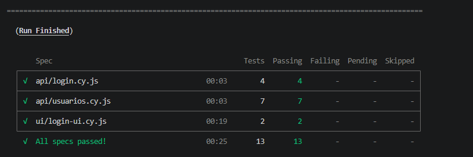
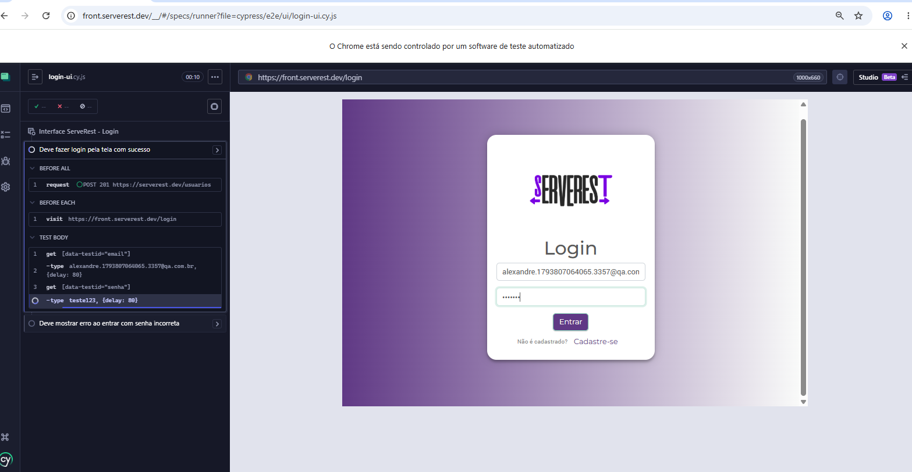
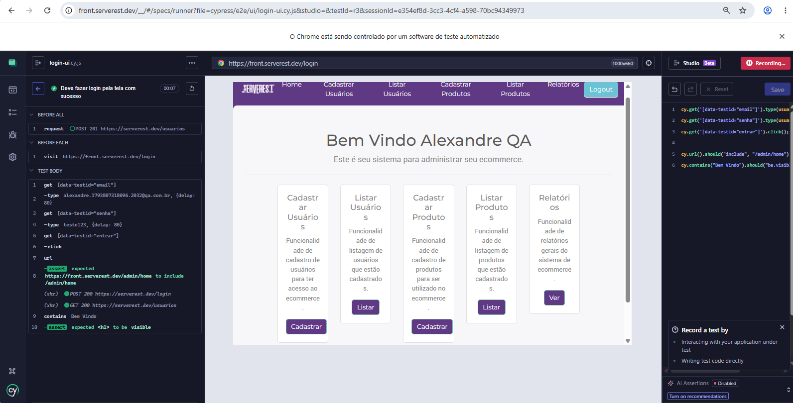

# Portfólio QA: Testes de API e Interface da ServeRest

Projeto de portfólio de Alexandre, Analista de Teste de Software, com testes de API e automação sobre a [ServeRest](https://serverest.dev), uma API pública criada para prática de QA.

## Escopo
- Login: `POST /login`
- Usuários: `POST /usuarios`, `GET /usuarios` e `GET /usuarios/{_id}`
- Interface: login pela tela em [front.serverest.dev](https://front.serverest.dev)

## Tecnologias
- Postman (testes manuais e validações automáticas na coleção)
- Cypress com JavaScript (automação de API e de interface)
- Git e GitHub

## Estrutura do projeto
```
postman/              coleção do Postman com 11 cenários
cypress/e2e/api/      testes de API (login e usuários)
cypress/e2e/ui/       testes de interface (login pela tela)
cypress/support/      comandos reutilizáveis (cy.criarUsuario)
evidencias/           prints das execuções
```

## Cenários automatizados (13)
**API: Login (4)**: login válido, senha errada, e-mail não cadastrado, e-mail em branco

**API: Usuários (7)**: cadastro válido, e-mail repetido, cadastro sem nome, cadastro sem senha, listar todos, buscar id com formato inválido, buscar id inexistente

**Interface: Login (2)**: login pela tela com sucesso, erro ao entrar com senha incorreta

## Como executar
Pré-requisito: Node.js instalado.

```
git clone https://github.com/AlexandreLiberal/portfolio-qa-serverest.git
cd portfolio-qa-serverest
npm install
npx cypress run --browser chrome
```

Para acompanhar os testes na tela, use `npx cypress open`.

## Decisões técnicas
- Cada teste cria o próprio usuário com e-mail único (`cy.criarUsuario`), porque a ServeRest apaga os dados todos os dias e não aceita e-mail repetido.
- Os mesmos cenários de login existem em API e em interface, para validar a regra de negócio e o que o usuário vê.

## Evidências



[Log completo da execução](evidencias/execucao-cypress.txt)

## Status
- [x] Coleção do Postman com 11 cenários, executada no Runner em 03/11/2026: 32 testes aprovados, 0 falhas
- [x] Automação com Cypress: 13 testes (11 de API e 2 de interface), todos aprovados em 04/11/2026
- [x] Documentação dos cenários em BDD: [docs/cenarios-bdd.md](docs/cenarios-bdd.md)
- [x] Registro de defeitos e observações: [docs/registro-defeitos-observacoes.md](docs/registro-defeitos-observacoes.md)